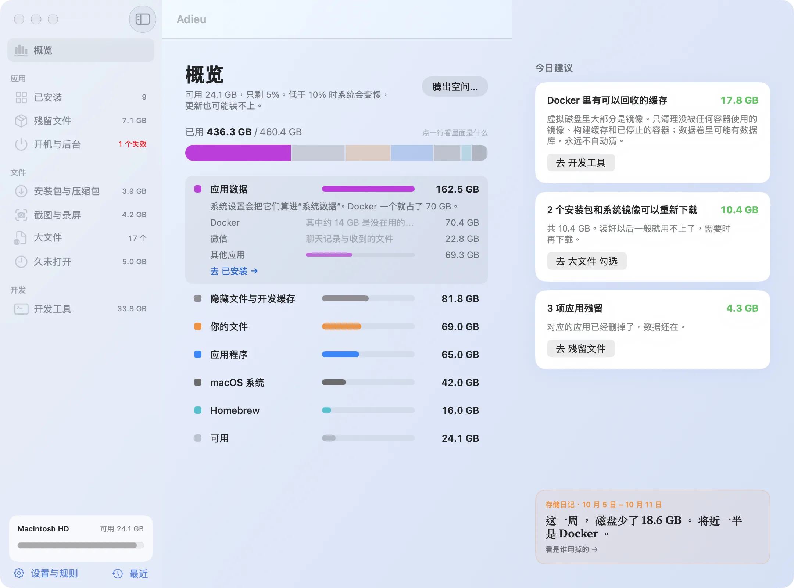
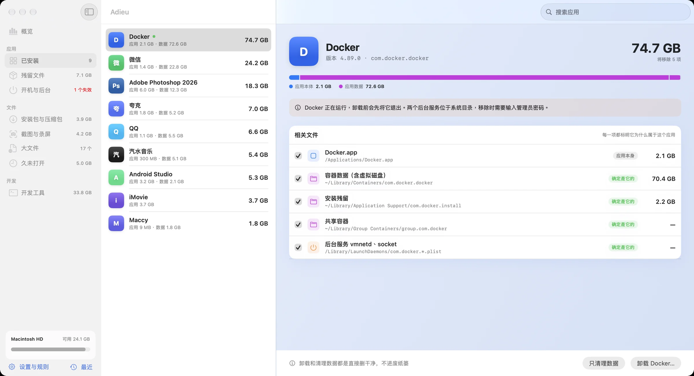
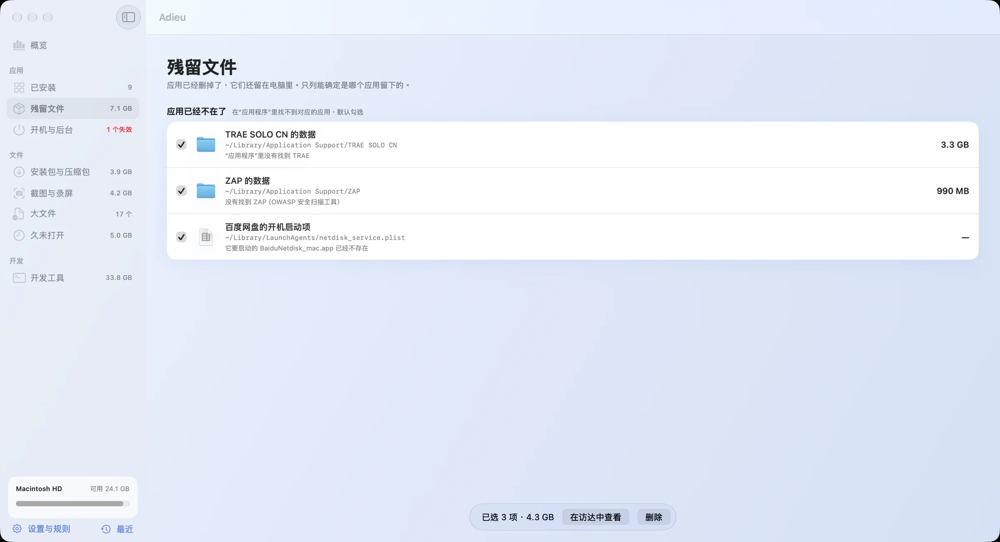
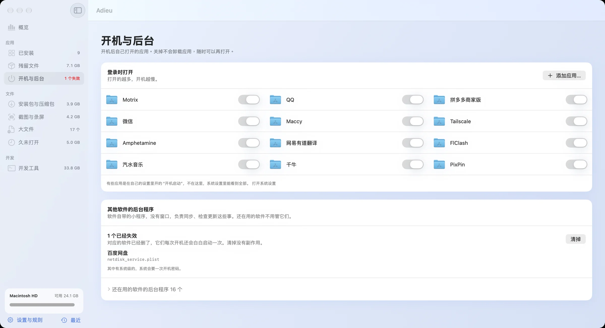
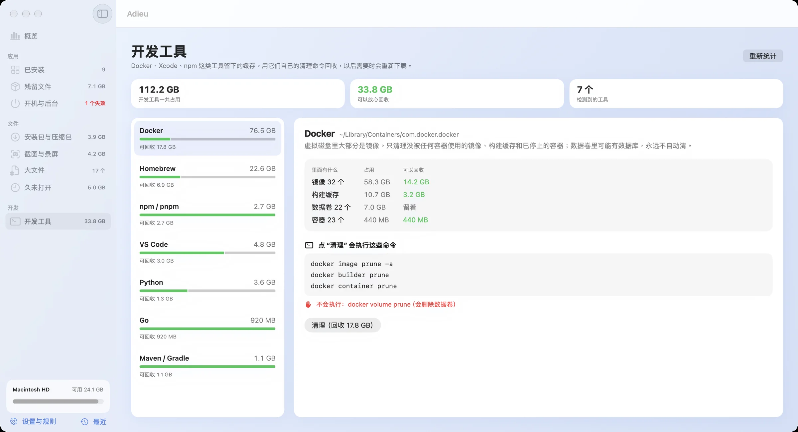

<div align="center">


# Adieu

**好好告别。**

给 Mac 里不再需要的东西，一次体面的告别。<br>
卸载应用连同它留下的一切，每一项都告诉你为什么可以删。

<br>

<a href="https://github.com/lijunyu726/adieu/releases"></a>

<sub>免费开源 · macOS 26 · Apple 芯片 · <a href="https://adieu.lijunyu.com.cn">官网</a> · <a href="https://adieu.lijunyu.com.cn/manual/">使用手册</a></sub>

<br><br>



</div>

<br>

## 为什么是 Adieu

把应用拖进废纸篓，只删掉了它的一半：缓存、容器数据、后台服务还留在资源库里。装完没删的安装包、几个月前的录屏、编译缓存，也在悄悄占满磁盘。

| 免费、开源 | 只在你的 Mac 上 | 先说清楚，再删 | 删就删干净 |
|:--|:--|:--|:--|
| 无订阅、无内购、无广告 | 不联网，不收集数据 | 写明来由，拿不准的不显示 | 直接删除，立刻腾出空间 |

## 功能

<table>
<tr>
<td width="50%" valign="top">

**卸载应用，连根带走**<br>
<sub>容器数据、缓存、后台服务一起列出，只认 Bundle ID，不靠名字猜。</sub>



</td>
<td width="50%" valign="top">

**残留文件**<br>
<sub>应用早就删了，数据还在 `~/Library`：只列能确定主人已经不在的。</sub>



</td>
</tr>
<tr>
<td width="50%" valign="top">

**开机与后台**<br>
<sub>登录项随手开关；程序已经不存在的后台服务，一键清掉。</sub>



</td>
<td width="50%" valign="top">

**给开发者**<br>
<sub>只清删了会自动重新下载的缓存，清理命令原样展示。</sub>



</td>
</tr>
</table>

开发工具支持 Docker、Homebrew、Xcode、Node.js（npm / pnpm / yarn / bun）、Python（uv、pip）、Conda、Go、Rust、Flutter、Maven / Gradle、Deno、Composer、VS Code / Cursor / Windsurf、JetBrains、Playwright / Puppeteer / Cypress / Electron。SDK、模型、工具链、Xcode 归档只告诉你多大，不替你做决定。

文件页（安装包与压缩包、截图与录屏、大文件、久未打开）：鼠标指着就在右边预览，整行点一下勾选、按住拖动连选；顶上一句建议一键勾上可以放心删的，按组全选；空格放大看，回车勾选或取消当前这个，⌘A 全选（再按一次全不选），esc 全部取消，⌘⌫ 删除已勾选（照样先确认），这些快捷键都以键帽的样子写在预览栏和底栏上，不用记。“逐个看”里 → 只是标成待删，看完再一起确认。

概览页右边的“今日建议”和各文件页顶上的建议是同一套规则，点“去 X 勾选”跳过去时已经替你勾好，删不删自己定。存储日记每次扫描记一次，讲清这几天空间去了哪：哪个应用、哪个文件夹多了多少，点一下就去那一页。

还有：按目标“腾出空间”、删除记录与磁盘日记、菜单栏与桌面小组件、自动规则、保护名单。

每个功能怎么用，配图写在 **[使用手册](https://adieu.lijunyu.com.cn/manual/)** 里；软件里点侧边栏底部的“?”或帮助菜单（⌘?）也能打开。

## 安装

1. 到 [Releases](https://github.com/lijunyu726/adieu/releases) 下载最新的 `Adieu-版本号.dmg`，把 Adieu 拖进“应用程序”。
2. 第一次打开如果被拦下（还没有经过 Apple 公证）：到 **系统设置 › 隐私与安全性**，点 **仍要打开**。

Adieu 只在这个仓库的 Releases 发布，别处下载的都不是官方版本。它免费、不订阅、不联网，也不会弹窗催你升级。

> [!WARNING]
> Adieu 的所有删除都是**直接删除，不进废纸篓**，删了不能放回。删除前会确认一次，“最近”里能看到每次删了什么。

<details>
<summary><b>权限</b></summary>

<br>

| 权限 | 用途 |
|---|---|
| 完全磁盘访问权限 | 读取其他应用的容器。没有时应用数据会被算进“系统与其他”，残留也会找漏。授权后按 ⌘R 重新扫描 |
| 自动化（System Events） | 读取和移除“登录时打开”的项目 |
| 通知 | 自动规则的提醒 |

</details>

<details>
<summary><b>已知限制</b></summary>

<br>

- 系统级后台程序（`/Library/LaunchAgents`、`/Library/LaunchDaemons`）只在程序已不存在时清理，且只动其中单个 plist
- Docker 不在运行时无法统计和清理
- 应用数据只认 Bundle ID 完全匹配；同一开发者还有应用在的、只有名字的残留都不列
- ad-hoc 签名：每次重新编译后系统可能重新询问文件夹访问权限；询问期间扫描会停住，超过一分钟页面会提示去点“允许”
- 管理员授权框不提供指纹（Touch ID）选项，需要输入开机密码

</details>

<details>
<summary><b>从源码构建</b></summary>

<br>

需要 Xcode 27 和 [XcodeGen](https://github.com/yonaskolb/XcodeGen)：

```bash
brew install xcodegen
xcodegen generate              # 新增或删除 Swift 文件后都要重新生成
xcodebuild -project Adieu.xcodeproj -scheme Adieu -configuration Debug \
  -derivedDataPath scratch/DerivedData build
open scratch/DerivedData/Build/Products/Debug/Adieu.app
```

调试参数（macOS 会自动读入 UserDefaults）：

```bash
# 跳过欢迎页、直接打开某一页、使用示例数据（示例模式下删除只是模拟，不动真实文件）
open -n scratch/DerivedData/Build/Products/Debug/Adieu.app --args \
  -didOnboard YES -AdieuSection apps -AdieuSample YES
```

`AdieuSection` 可选值见 `Adieu/App/RootView.swift` 的 `AppSection`；`-AdieuSheet goal`（goal、history、diary）直接打开对应面板。`-AdieuLaunchHidden YES` 模拟开机自启：不弹主窗口，只在后台扫描、跑自动规则。截图用：`-AdieuFileMode grid|list|cards`（文件页的查看方式）、`-AdieuUninstall YES`（直接打开第一个应用的卸载确认）、`-AdieuSettingsTab rules`（safety、rules、general、permissions、about）、`-AdieuSheet menuBar` / `onboarding`（菜单栏面板、欢迎页放在窗口里显示）。

打包安装包（需要 [uv](https://docs.astral.sh/uv/)，用固定版本的 dmgbuild 排安装窗口）：

```bash
scripts/make-dmg.sh            # Release 编译，输出 scratch/Adieu-<版本>.dmg
```

**技术栈**：SwiftUI + Swift 6，最低 macOS 26，WidgetKit 小组件；工程由 XcodeGen 从 `project.yml` 生成，`.xcodeproj` 不进仓库；不开沙盒（卸载需要读写 `~/Library` 与 `/Applications`），因此不走 Mac App Store；没有第三方依赖，也没有网络请求。

```
project.yml          XcodeGen 配置
Adieu/App/           入口、导航、全局状态
Adieu/Design/        共享界面组件
Adieu/Data/          模型、示例数据、腾出空间的计划算法
Adieu/Scan/          真实数据读取（磁盘、应用、文件、残留、后台项、开发工具），只读
Adieu/Actions/       会改动文件的操作：删除、历史、自动规则、日记、权限、通知
Adieu/Features/      各页面
Adieu/AppIcon.icon/  应用图标（Icon Composer 格式）
AdieuWidget/         桌面小组件
scripts/             打包脚本与安装窗口素材
docs/images/         README 截图（示例数据）
```

</details>

## 许可

[MIT](LICENSE) © 2026 李俊宇
