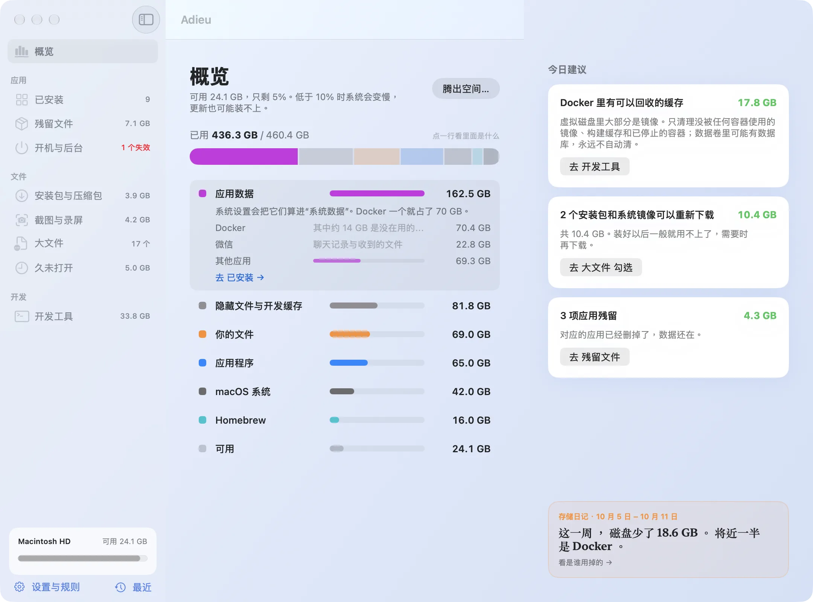
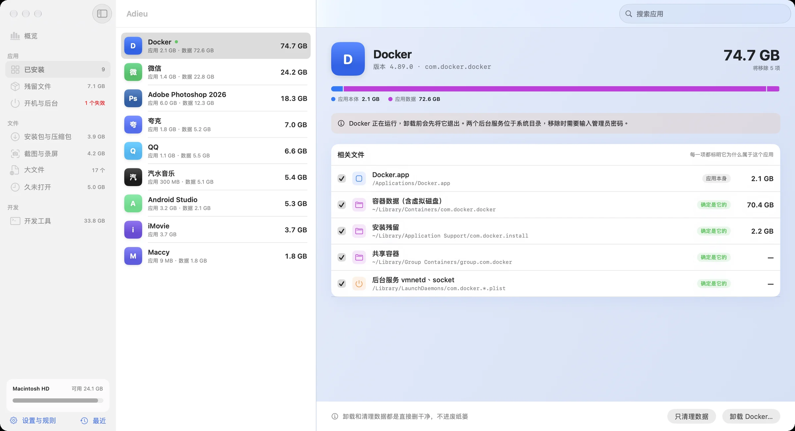
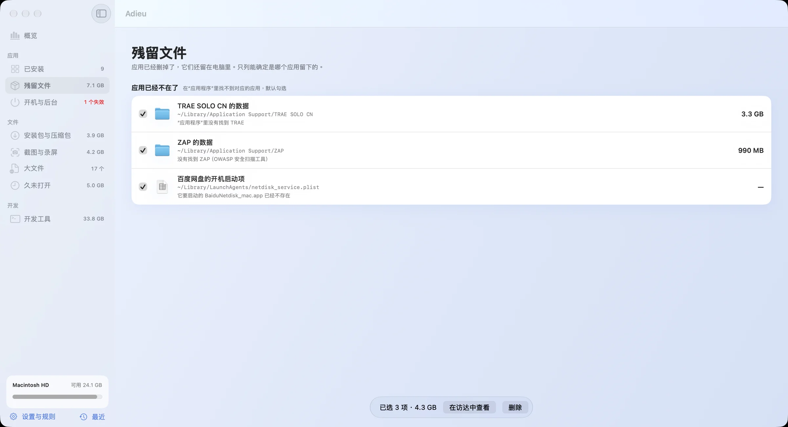
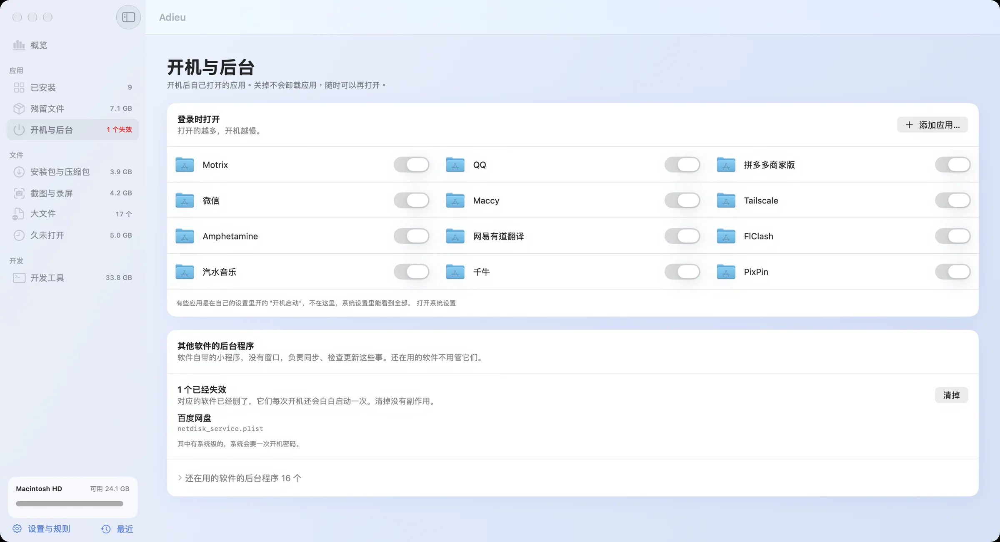
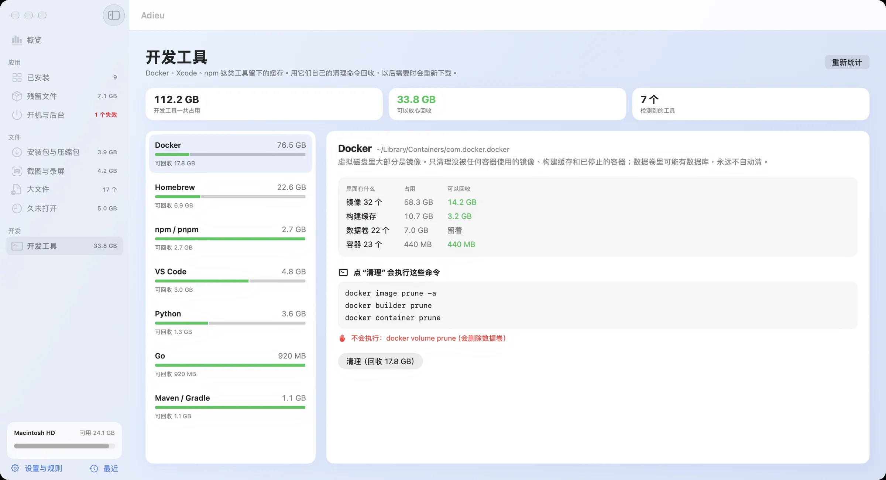

<div align="center">


# Adieu

**好好告别。**

给 Mac 里不再需要的东西，一次体面的告别。<br>
卸载应用连同它留下的一切，每一项都告诉你为什么可以删。

<br>

<a href="https://github.com/lijunyu726/adieu/releases"></a>

<sub>免费开源 · macOS 26 · Apple 芯片 · <a href="https://adieu.lijunyu.com.cn">官网</a> · <a href="https://adieu.lijunyu.com.cn/manual/">使用手册</a></sub>

<br><br>



<br>

https://github.com/user-attachments/assets/0852fe93-0a46-440b-9b32-ae43faf6a4bd

</div>

<br>

## English overview

Adieu is a free, MIT-licensed macOS uninstaller and cleanup app built with SwiftUI. It finds app caches, container data, and background services by Bundle ID, and explains why each item can be removed before you delete it. It also helps you review app leftovers, old installers, screenshots, screen recordings, large files, developer caches, and Git worktrees.

Adieu only contacts GitHub when checking for updates. Scanning and cleanup stay on your Mac. It has no subscriptions, ads, or in-app purchases. Requires **macOS 26 and Apple silicon**. If a newer version is available, Adieu asks first, then downloads it and replaces itself.

[Download from GitHub Releases](https://github.com/lijunyu726/adieu/releases) · [Website](https://adieu.lijunyu.com.cn) · [User manual (Chinese)](https://adieu.lijunyu.com.cn/manual/)

**Deletion is permanent: items do not go to the Trash.** Most deletions ask for confirmation by default, but the menu bar delete action and removal of invalid background services act immediately. The app is not notarized; macOS may require you to allow it in System Settings → Privacy & Security on first launch, and again after it replaces itself.

## 为什么是 Adieu

把应用拖进废纸篓，只删掉了它的一半：缓存、容器数据、后台服务还留在资源库里。装完没删的安装包、几个月前的录屏、编译缓存，也在悄悄占满磁盘。

| 免费、开源 | 只在你的 Mac 上 | 先说清楚，再删 | 删就删干净 |
|:--|:--|:--|:--|
| 无订阅、无内购、无广告 | 只在检查更新时联网，不收集数据 | 写明来由，拿不准的不显示 | 直接删除，立刻腾出空间 |

## 功能

<table>
<tr>
<td width="50%" valign="top">

**卸载应用，连根带走**<br>
<sub>容器数据、缓存、后台服务一起列出，只认 Bundle ID，不靠名字猜。</sub>



</td>
<td width="50%" valign="top">

**残留文件**<br>
<sub>应用早就删了，数据还在 `~/Library`：只列能确定主人已经不在的。</sub>



</td>
</tr>
<tr>
<td width="50%" valign="top">

**开机与后台**<br>
<sub>登录项随手开关；程序已经不存在的后台服务，一键清掉。</sub>



</td>
<td width="50%" valign="top">

**给开发者**<br>
<sub>只清删了会自动重新下载的缓存，清理命令原样展示。</sub>



</td>
</tr>
</table>

开发工具支持 Docker、Homebrew、Xcode、Node.js（npm / pnpm / yarn / bun）、Python（uv、pip）、Conda、Go、Rust、Flutter、Maven / Gradle、Deno、Composer、VS Code / Cursor / Windsurf、JetBrains、Playwright / Puppeteer / Cypress / Electron。SDK、模型、工具链、Xcode 归档只告诉你多大，不替你做决定。

开发工具里的 **Git worktree** 按项目显示分支、路径、占用与状态。已合并且工作区干净的显示蓝色“安全移除”；未提交、未合并、锁定、游离 HEAD、Git 操作未结束、子模块等显示红色“强制移除”，分别确认后执行展示的 Git 命令。主工作区和主分支不提供移除；包含其他工作区、状态无法确认或 Git 版本未经验证的也保留。**移除会直接删除整个目录（含 Git 忽略的文件），强制移除还会丢失未提交改动，游离 HEAD 的独有提交也可能丢失。** 已有分支保留。移除要求系统自带的 Git（Apple Git）不低于 2.50，已实测 2.50.1 和 2.54.0；更低的版本只展示。项目列表、选中项和结果缓存在本机；超过 5 分钟后台更新，也可点“重新统计”。

打开「开发工具 → **Agent 技能**」，可以管理 Codex、Claude Code 和 DeepSeek Harness 的本机用户级技能。选中一个技能后，可分别为各个 agent 启用或停用，也可以用「全部停用」一次关闭，再用「恢复启用」恢复之前启用的 agent。

- **仅点名调用**：在 Codex 输入 `$技能名`，在 Claude Code 或 DeepSeek Harness 输入 `/技能名`。修改后可以新开一个 agent 会话加载设置。
- **卸载技能**：选中技能后点「卸载技能」，核对列出的启用项和停用备份，再确认永久删除。符号链接只移除链接，指向的源文件若也在确认列表中，则按该条目处理。删除成功的条目可在「最近」查看。
- **同名技能的停用与恢复**：停用时，技能会移到对应配置目录下的 `adieu-disabled-skills`。如果外部工具重新安装了同名技能，再次停用时会分别保留新旧两份。恢复到同一安装位置时，优先使用最近停用的一份，较早的版本仍可在停用目录中找到。
- **共享技能**：为新的 agent 启用时会复制技能文件。单独停用 Codex 或 DeepSeek Harness 的共享技能时，仍启用的一方会使用自己的目录。其他读取共享目录的客户端也会看到目录变化。指向同一源文件的链接共用该文件的调用策略。

Adieu 扫描 `~/.agents/skills`、`~/.codex/skills`、`~/.claude/skills` 和 `~/.dsh/skills`，并读取 Adieu 进程环境中的 `CODEX_HOME`、`CLAUDE_CONFIG_DIR`、`DSH_HOME`、`DSH_AGENTS_HOME` 覆盖路径。项目、插件、同步和内置技能由对应客户端管理。客户端自身的配置可以覆盖本机的发现和调用规则。

在「文件 → **iCloud Drive**」查看已扫描文件的本机占用，按占用从大到小排列。可显示仅在云端的文件。勾选已同步且 macOS 标为可回收的文件，再确认「移除下载」，云端文件仍可重新下载。正在同步、有待同步更改、系统要求保留或状态不明确的项目会跳过。扫描范围为当前用户的 iCloud Drive 普通文件。 此页面还可以按文件名或路径搜索、新建文件夹、重命名单个文件，以及把选中的文件批量移动到现有文件夹。云端占位文件也可以整理。更改会通过 iCloud 同步到其他设备，遇到同名项目会保留两边并报告该项。

文件页（安装包与压缩包、图片与视频、大文件、久未打开）：鼠标指着就在右边预览，整行点一下勾选、按住拖动连选；顶上一句建议一键勾上可以放心删的，按组全选；空格放大看，回车勾选或取消当前这个，⌘A 全选（再按一次全不选），esc 全部取消，⌘⌫ 删除已勾选（照样先确认），这些快捷键都以键帽的样子写在预览栏和底栏上，不用记。“逐个看”里 → 只是标成待删，看完再一起确认。

概览页右边的“今日建议”和各文件页顶上的建议是同一套规则，点“去 X 勾选”跳过去时已经替你勾好，删不删自己定。存储日记每次扫描记一次，讲清这几天空间去了哪：哪个应用、哪个文件夹多了多少，点一下就去那一页。

还有：按目标“腾出空间”、删除记录与磁盘日记、菜单栏与桌面小组件、自动规则、保护名单。

每个功能怎么用，配图写在 **[使用手册](https://adieu.lijunyu.com.cn/manual/)** 里；软件里点侧边栏底部的“?”或帮助菜单（⌘?）也能打开。

## 安装

1. 到 [Releases](https://github.com/lijunyu726/adieu/releases) 下载最新的 `Adieu-版本号.dmg`，把 Adieu 拖进“应用程序”。
2. 第一次打开如果被拦下（还没有经过 Apple 公证）：到 **系统设置 › 隐私与安全性**，点 **仍要打开**。

Adieu 只在这个仓库的 Releases 发布，别处下载的都不是官方版本。它免费、不订阅，只在检查更新时联网。有新版本会问你要不要更新。同意的话，它自己下载并换上，然后重新打开。还没有公证，所以换上之后第一次打开可能要再点一次“仍要打开”，完全磁盘访问权限也可能要重新允许。

> [!WARNING]
> Adieu 的所有删除都是**直接删除，不进废纸篓**，删了不能放回。卸载应用、删文件前默认会确认一次；菜单栏面板的“删除”和清掉失效的后台程序点了就做。“最近”里能看到每次删了什么。

在「概览」点击「清空废纸篓…」，确认后可以永久删除启动盘上当前用户废纸篓中的项目。「最近」会记录成功清理的条目。

<details>
<summary><b>权限</b></summary>

<br>

| 权限 | 用途 |
|---|---|
| 完全磁盘访问权限 | 读取其他应用的容器。没有时应用数据会被算进“系统与其他”，残留也会找漏。授权后按 ⌘R 重新扫描 |
| 自动化（System Events） | 读取和移除“登录时打开”的项目 |
| 通知 | 自动规则的提醒 |

</details>

<details>
<summary><b>已知限制</b></summary>

<br>

- 系统级后台程序（`/Library/LaunchAgents`、`/Library/LaunchDaemons`）只在程序已不存在时清理，且只动其中单个 plist
- Docker 不在运行时无法统计和清理
- 应用还开着时，卸载确认框会提醒它还开着，按钮是“取消”和“强制退出并卸载”；“只清理数据”会提示“某某没有退出”，按钮是“取消”和“强制退出并清理”。强制退出会丢掉没保存的内容，想先保存就取消，自己退出后再来
- 第三方输入法（`/Library/Input Methods`、`~/Library/Input Methods`）也列在应用里，卸载前先在系统里停用；装在 `/Library` 的要输入开机密码，删完要注销或重启一次，输入法菜单里才彻底消失
- 应用数据按主程序和包内扩展、辅助程序的 Bundle ID 完全匹配，也读取声明的共享组；其他应用共用的数据默认不勾。卸载时还会找 `Application Support`、`Caches`、`HTTPStorages`、`Logs` 里和应用包英文名完全相同的文件夹（如 `Application Support/WeType`；也试去空格、空格换成 `-` 或 `_`、去掉 Beta 等版本后缀的写法），标“按名字找到”，默认勾选；名字短于 5 个字符、是通用词或和别的已装应用同名时不找。残留扫描仍只认标识符，同一开发者还有应用在的、只有名字的残留都不列
- 自签证书签名（0.1.14 起）：同一台打包机签出来的版本，系统认作同一个应用，更新后不用重新允许权限；从 0.1.13 及以前更新到 0.1.14 要再允许一次。没有 Apple 公证，第一次打开仍可能要点“仍要打开”。本地 Xcode 直接编译的版本还是临时签名，每次编译后系统可能重新询问文件夹访问权限
- 管理员授权框不提供指纹（Touch ID）选项，需要输入开机密码

</details>

<details>
<summary><b>从源码构建</b></summary>

<br>

需要 Xcode 27 和 [XcodeGen](https://github.com/yonaskolb/XcodeGen)：

```bash
brew install xcodegen
xcodegen generate              # 新增或删除 Swift 文件后都要重新生成
xcodebuild -project Adieu.xcodeproj -scheme Adieu -configuration Debug \
  -derivedDataPath scratch/DerivedData build
open scratch/DerivedData/Build/Products/Debug/Adieu.app
```

调试参数（macOS 会自动读入 UserDefaults）：

```bash
# 跳过欢迎页、直接打开某一页、使用示例数据（示例模式下删除只是模拟，不动真实文件）
open -n scratch/DerivedData/Build/Products/Debug/Adieu.app --args \
  -didOnboard YES -AdieuSection apps -AdieuSample YES
```

`-AdieuWorktrees YES` 在开发工具页直接显示 worktree，`-AdieuAgentSkills YES` 直接显示 Agent 技能（可与 `-AdieuSection devTools -AdieuSample YES` 组合）。

`AdieuSection` 可选值见 `Adieu/App/RootView.swift` 的 `AppSection`；`-AdieuSheet goal`（goal、history、diary）直接打开对应面板。`-AdieuLaunchHidden YES` 模拟开机自启：不弹主窗口，只在后台扫描、跑自动规则。截图用：`-AdieuFileMode grid|list|cards`（文件页的查看方式）、`-AdieuUninstall YES`（直接打开第一个应用的卸载确认）、`-AdieuSettingsTab rules`（safety、rules、general、permissions、about）、`-AdieuSheet menuBar` / `onboarding`（菜单栏面板、欢迎页放在窗口里显示）。

应用组件、共享组、脚本目录与残留归属验证：`scripts/test-app-scanner.sh`。只创建临时应用和数据，不卸载已安装的软件。

Agent 技能的临时目录验证可运行 `scripts/test-agent-skills.sh`。

Worktree 的临时仓库验证：`scripts/test-worktrees.sh`；删除后文件分类、侧边栏、建议与扫描竞态验证：`scripts/test-worktree-model.sh`。全部测试目录和产物在 `scratch/`，不清理真实项目。

打包安装包（需要 [uv](https://docs.astral.sh/uv/)，用固定版本的 dmgbuild 排安装窗口）：

```bash
scripts/make-dmg.sh            # Release 编译，输出 scratch/Adieu-<版本>.dmg
```

**技术栈**：SwiftUI + Swift 6，最低 macOS 26，WidgetKit 小组件；工程由 XcodeGen 从 `project.yml` 生成，`.xcodeproj` 不进仓库；不开沙盒（卸载需要读写 `~/Library` 与 `/Applications`），因此不走 Mac App Store；没有第三方依赖，也没有网络请求。

```
project.yml          XcodeGen 配置
Adieu/App/           入口、导航、全局状态
Adieu/Design/        共享界面组件
Adieu/Data/          模型、示例数据、腾出空间的计划算法
Adieu/Scan/          真实数据读取（磁盘、应用、文件、残留、后台项、开发工具），只读
Adieu/Actions/       会改动文件的操作：删除、历史、自动规则、日记、权限、通知
Adieu/Features/      各页面
Adieu/AppIcon.icon/  应用图标（Icon Composer 格式）
AdieuWidget/         桌面小组件（小、中、大三种）
Shared/              主程序和小组件共用的代码（写给小组件的扫描结果）
scripts/             打包脚本与安装窗口素材
docs/images/         README 截图（示例数据）
```

</details>

## 许可

[MIT](LICENSE) © 2026 李俊宇
